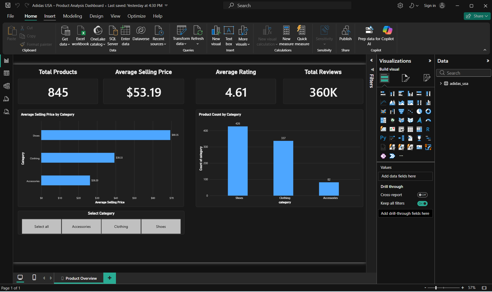

# Adidas USA – Product Analysis Dashboard

## 📊 Project Overview

I developed an interactive Power BI dashboard using an Adidas USA product dataset to analyse product categories, selling prices, customer ratings, and product reviews.

The objective was to transform raw Excel data into a clear, interactive dashboard that helps users understand product distribution and pricing patterns.

## 🛠️ Tools & Technologies

- **Microsoft Power BI Desktop** – Dashboard development and data visualization
- **Power Query** – Data import, validation, and transformation
- **Microsoft Excel** – Source dataset

## 📁 Dataset Information

The dataset contains 845 product records across three categories:

- Shoes
- Clothing
- Accessories

Key columns used in this analysis include:

- `category`
- `selling_price`
- `average_rating`
- `reviews_count`

## 📈 Dashboard KPIs

| KPI | Value |
|---|---|
| Total Products | 845 |
| Average Selling Price | $53.19 |
| Average Product Rating | 4.61 |
| Total Reviews | Approximately 360K |

## 📊 Dashboard Visualizations

**1. Product Count by Category**

A clustered column chart showing the number of products in each category.

**2. Average Selling Price by Category**

A clustered bar chart comparing average product prices across categories.

**3. KPI Cards**

Four KPI cards displaying total products, average selling price, average rating, and total reviews.

**4. Interactive Category Slicer**

Allows users to filter the dashboard by product category. All connected visuals update according to the selected category.

## 🔍 Key Business Insights

- Shoes represent the largest product category, with 426 products.
- Shoes have the highest average selling price at $69.35.
- Clothing has an average selling price of $39.33.
- Accessories have the lowest average selling price at $26.20.
- The overall average product rating is 4.61.

These findings highlight differences in product distribution and pricing across categories.

## 🧹 Data Preparation

The following tasks were performed using Power Query:

- Imported the Excel dataset
- Reviewed column quality
- Checked for missing and invalid values
- Verified data types
- Removed unnecessary columns
- Loaded the cleaned dataset into Power BI

## 🎯 Skills Demonstrated

- Excel Data Import
- Power Query Basics
- Data Quality Validation
- Data Aggregation (Count, Sum, Average)
- KPI Card Creation
- Clustered Column and Bar Charts
- Interactive Slicers
- Currency Formatting
- Dashboard Design and Layout

## 🖼️ Dashboard Preview

## 📂 Project Files

| File | Description |
|---|---|
| `Adidas_Product_Analysis.pbix` | Power BI dashboard file |
| `adidas_usa.xlsx` |	Original Excel dataset used for analysis |
| `dashboard.png` | Dashboard screenshot |
| `README.md` | Project documentation |

## 📚 Learning Outcome

This beginner-level project helped me understand how to import data, create meaningful visualizations, develop KPI cards, and build interactive reports using Microsoft Power BI.

It represents my first practical step towards developing advanced Business Intelligence and Data Analytics skills.

