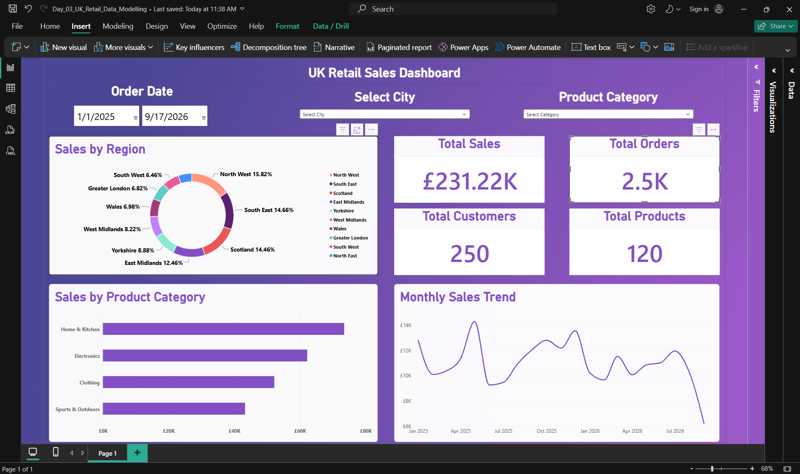

# UK Retail Sales – Data Modelling & Interactive Dashboard

## 📊 Project Overview

I developed an interactive Power BI dashboard using a realistic, simulated UK retail sales dataset to analyse sales performance, customer distribution, product categories, and monthly sales trends.

The main objective was to understand Power BI data modelling concepts, create and validate relationships between multiple tables, implement a Star Schema, and develop an interactive sales dashboard.

This project focuses on data modelling, relationship management, and business intelligence reporting using Microsoft Power BI.

## 🛠️ Tools & Technologies

- **Microsoft Power BI Desktop** – Data modelling, dashboard development, and visualization
- **Power Query Editor** – Data import and data type validation
- **Microsoft Excel** – Source dataset containing three related tables
- **Power BI Model View** – Relationship creation, verification, and management

## 📁 Dataset Information

The dataset contains **2,870 records** distributed across three tables:

| Table | Records | Description |
|---|---:|---|
| Customers | 250 | Customer information, including city and region |
| Products | 120 | Product details, categories, and prices |
| Sales | 2,500 | Sales transactions, order dates, quantities, and sales amounts |
| **Total** | **2,870** | |

The dataset contains realistic, simulated UK retail business data designed for Power BI data modelling and reporting practice.

### Dataset Tables

**1. Customers — Dimension Table**

Contains customer information used for geographical and customer-based analysis.

Key fields:
- `CustomerID`
- `CustomerName`
- `City`
- `Region`

**2. Products — Dimension Table**

Contains product information used for category-based sales analysis.

Key fields:
- `ProductID`
- `ProductName`
- `Category`
- `UnitPrice`

**3. Sales — Fact Table**

Contains sales transactions and measurable business data.

Key fields:
- `SaleID`
- `CustomerID`
- `ProductID`
- `OrderDate`
- `SalesAmount`

## 🔗 Data Modelling & Relationships

Implemented a **Star Schema** consisting of one central fact table and two dimension tables.

### Star Schema Structure

- **Fact Table:** Sales
- **Dimension Tables:** Customers and Products

### Table Relationships

| From Table | To Table | Cardinality |
|---|---|---|
| Customers[CustomerID] | Sales[CustomerID] | One-to-Many (1:*) |
| Products[ProductID] | Sales[ProductID] | One-to-Many (1:*) |

These relationships enable customer-based and product-based analysis across the Sales fact table.

### Relationship Concepts Practised

**1. Relationship Cardinality**

Verified One-to-Many relationships between dimension and fact tables.

**2. Cross-filter Direction**

Explored Single and Both cross-filter directions to understand how filters propagate between related tables.

**3. Active and Inactive Relationships**

Practised enabling and disabling relationships and observed their effects on report filtering.

**4. Automatic Relationship Detection**

Explored how Power BI automatically detects relationships between imported tables based on matching columns and data values.

**5. Star Schema vs Snowflake Schema**

Studied the differences between Star Schema and Snowflake Schema, including their structures and use cases.

Implemented Star Schema practically, while Snowflake Schema was covered theoretically.

## 🧹 Data Preparation

The following tasks were performed using Power Query and Power BI:

- Imported three Excel tables into Power BI
- Reviewed column data types across all tables
- Verified text, date, and numeric data types
- Applied British Pound (£) currency formatting
- Inspected automatically detected table relationships
- Verified relationship cardinality
- Reviewed cross-filter direction
- Tested active and inactive relationships
- Validated filtering behaviour across related tables

The prepared dataset was then used to develop an interactive sales dashboard.

## 📈 Dashboard KPIs

| KPI | Value |
|---|---|
| Total Sales | £231.22K |
| Total Orders | 2,500 |
| Total Customers | 250 |
| Total Products | 120 |

These KPIs provide a high-level overview of the retail business.

## 📊 Dashboard Visualizations

**1. Sales by Region**

A donut chart displaying the percentage contribution of each UK region to total sales.

**2. Sales by Product Category**

A clustered bar chart comparing total sales across product categories.

The chart helps identify which categories contribute the most revenue.

**3. Monthly Sales Trend**

A line chart showing monthly sales performance over time.

This visualization helps identify sales fluctuations and trends.

**4. KPI Cards**

Four KPI cards displaying:

- Total Sales
- Total Orders
- Total Customers
- Total Products

**5. Interactive Slicers**

Three slicers were added to support interactive analysis:

- **Order Date:** Filter sales by a selected date range
- **City:** Filter sales based on customer location
- **Product Category:** Analyse sales for selected product categories

## 🔍 Key Business Insights

Based on the dashboard:

- Total retail sales reached approximately **£231.22K** across 2,500 transactions.
- The dataset includes 250 customers and 120 products.
- **Home & Kitchen** generated the highest total sales among the product categories.
- **Electronics** was the second-highest sales category.
- **North West** contributed approximately 15.82% of total sales.
- **South East** contributed approximately 14.66% of total sales.
- Monthly sales fluctuated throughout the reporting period, indicating variations in sales performance over time.

These findings demonstrate how a structured data model supports meaningful business analysis.

## 🎯 Skills Demonstrated

- Power BI Data Modelling
- Fact and Dimension Tables
- Star Schema Implementation
- Star Schema vs Snowflake Schema
- Primary and Foreign Keys
- One-to-Many Relationships
- Automatic Relationship Detection
- Relationship Cardinality
- Single and Both Cross-filter Directions
- Active and Inactive Relationships
- Power Query Data Type Validation
- Currency Formatting (£)
- Data Aggregation
- KPI Card Creation
- Clustered Bar Charts
- Line Charts
- Donut Charts
- Interactive Slicers
- Relationship-Based Filtering
- Dashboard Design and Formatting

## 🖼️ Dashboard Preview

[View Day 3 UK Retail Sales Dashboard](dashboard.png)

The dashboard presents sales performance, product category comparisons, regional sales distribution, and monthly sales trends.

## 📂 Project Files

| File | Description |
|---|---|
| `Day_03_UK_Retail_Data_Modelling.pbix` | Power BI project containing the data model, relationships, and interactive dashboard |
| `Day3_UK_Retail_3_Tables.xlsx` | Excel dataset containing Customers, Products, and Sales tables |
| `dashboard.png` | Screenshot of the completed Power BI dashboard |
| `README.md` | Project documentation |

## 📚 Learning Outcome

This project helped me understand how to design and manage a relational data model in Microsoft Power BI.

I gained practical experience working with fact and dimension tables, implementing a Star Schema, verifying relationships, managing cross-filter directions, and understanding active and inactive relationships.

I also learned how to use relationships between multiple tables to build interactive reports and analyse business performance.
