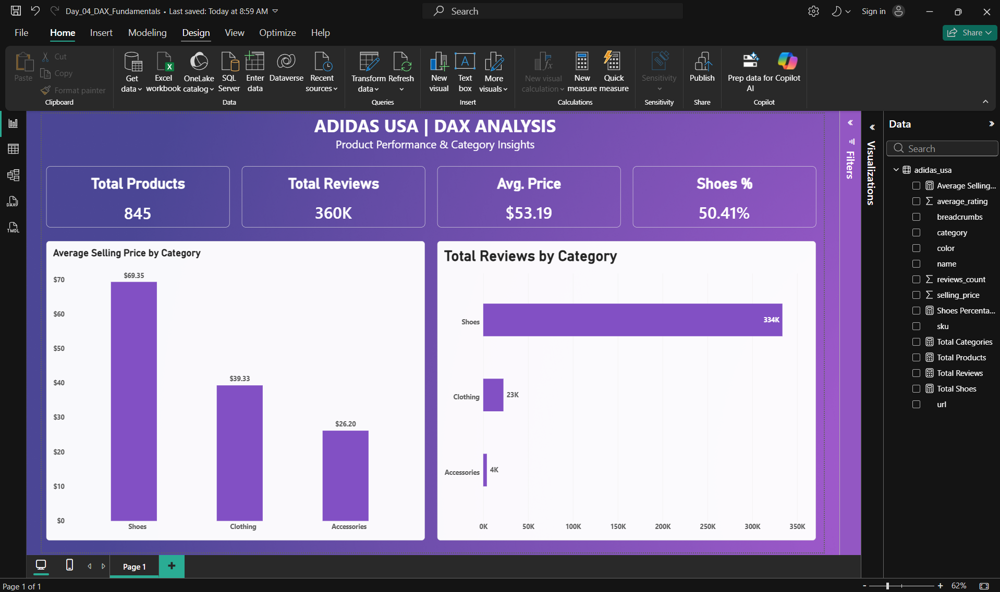

# Adidas USA – DAX Fundamentals & Product Performance Dashboard

## 📊 Project Overview

I developed a Power BI dashboard using the Adidas USA product dataset to practise DAX (Data Analysis Expressions) and analyse product performance across different categories.

The main objective was to understand DAX fundamentals, create reusable measures, perform dynamic calculations, explore filter context, and build a professional dashboard displaying meaningful business insights.

## 🛠️ Tools & Technologies

- **Microsoft Power BI Desktop** – DAX calculations, dashboard development, and data visualization
- **DAX (Data Analysis Expressions)** – Creating measures and performing calculations
- **Microsoft Excel** – Source dataset
- **Power BI Report View** – KPI cards, charts, and dashboard formatting

## 📁 Dataset Information

The dataset contains **845 Adidas USA product records** across three main categories:

- Shoes
- Clothing
- Accessories

Key columns used in the analysis include:

- `category`
- `selling_price`
- `reviews_count`
- `average_rating`
- `sku`

**Dataset Source:** The original `adidas_usa.xlsx` dataset is included in the [Day 4 Project Folder](https://github.com/Alirazasadaq6/Power-BI-Practice/blob/main/Day-04-DAX-Fundamentals/adidas_usa.xlsx).

## 🧮 DAX Measures & Calculations

The following DAX measures were created and practised during this project.

### 1. Total Products

```dax
Total Products = COUNTROWS('adidas_usa')
```

Counts the total number of product records in the dataset.

**Result:** 845 products

### 2. Total Reviews

```dax
Total Reviews = SUM('adidas_usa'[reviews_count])
```

Calculates the total number of customer reviews across all products.

**Result:** Approximately 360K reviews

### 3. Average Selling Price

```dax
Average Selling Price = AVERAGE('adidas_usa'[selling_price])
```

Calculates the average selling price of Adidas products.

**Result:** $53.19

### 4. Total Categories

```dax
Total Categories = DISTINCTCOUNT('adidas_usa'[category])
```

Counts the number of distinct product categories.

**Result:** 3 categories

### 5. Products With Price

```dax
Products With Price = COUNT('adidas_usa'[selling_price])
```

Counts the nonblank numeric values in the selling price column.

**Result:** 845 products

### 6. Total Shoes

```dax
Total Shoes =
CALCULATE(
    COUNTROWS('adidas_usa'),
    'adidas_usa'[category] = "Shoes"
)
```

Calculates the number of products belonging to the Shoes category by modifying the filter context.

### 7. Shoes Percentage

```dax
Shoes Percentage =
DIVIDE(
    [Total Shoes],
    [Total Products],
    0
)
```

Calculates the percentage of total products belonging to the Shoes category.

**Result:** 50.41%

## 📈 Dashboard KPIs

| KPI | Value |
|---|---|
| Total Products | 845 |
| Total Reviews | Approximately 360K |
| Average Selling Price | $53.19 |
| Shoes Percentage | 50.41% |
| Total Categories | 3 |

These KPIs provide a high-level overview of Adidas product distribution, pricing, and customer engagement.

## 📊 Dashboard Visualizations

### 1. KPI Cards

Four KPI cards displaying:

- Total Products
- Total Reviews
- Average Selling Price
- Shoes Percentage

The cards provide a quick summary of key product performance metrics.

### 2. Average Selling Price by Category

A clustered column chart comparing average selling prices across the three product categories.

| Category | Average Selling Price |
|---|---|
| Shoes | $69.35 |
| Clothing | $39.33 |
| Accessories | $26.20 |

This visualization helps identify differences in product pricing across categories.

### 3. Total Reviews by Category

A clustered bar chart comparing customer reviews across product categories.

| Category | Total Reviews (Approx.) |
|---|---|
| Shoes | 334K |
| Clothing | 23K |
| Accessories | 4K |

This visualization highlights differences in customer engagement across categories.

## 🔍 Key Business Insights

Based on the dashboard:

- Shoes represent **50.41%** of the total product records.
- Shoes have the highest average selling price at **$69.35**.
- Clothing has an average selling price of **$39.33**.
- Accessories have the lowest average selling price at **$26.20**.
- Shoes receive the highest number of customer reviews, approximately **334K**.
- Clothing receives approximately **23K** customer reviews.
- Accessories receive approximately **4K** customer reviews.
- The overall average selling price is **$53.19**.

These findings highlight differences in product pricing, distribution, and customer engagement.

## ⚙️ DAX Concepts Practised

### 1. Measures vs Calculated Columns

Studied the differences between DAX measures and calculated columns, including their calculation behaviour and usage in Power BI.

### 2. Aggregation Functions

Practised the following DAX functions:

- `SUM()`
- `AVERAGE()`
- `COUNT()`
- `COUNTROWS()`
- `DISTINCTCOUNT()`

### 3. Filter Context

Explored how DAX measures return different results depending on the categories and filters applied to report visuals.

### 4. CALCULATE Function

Used `CALCULATE()` to modify filter context and count products belonging to the Shoes category.

### 5. DIVIDE Function

Used `DIVIDE()` to calculate percentages and handle division-by-zero scenarios safely.

### 6. DAX Measure Formatting

Applied appropriate formatting to measures, including:

- Currency formatting
- Percentage formatting
- Decimal places
- Display units

## 🎯 Skills Demonstrated

- DAX Measure Creation
- Aggregation Functions
- Measures vs Calculated Columns
- Filter Context Understanding
- CALCULATE Function
- DIVIDE Function
- Percentage Calculations
- Category-Based Product Analysis
- KPI Card Creation
- Clustered Column Charts
- Clustered Bar Charts
- Data Label Formatting
- Currency and Percentage Formatting
- Dashboard Alignment and Spacing
- Professional Dashboard Design
- Business Insights Generation

## 🖼️ Dashboard Preview



[View Day 4 Adidas USA DAX Dashboard](https://github.com/Alirazasadaq6/Power-BI-Practice/blob/main/Day-04-DAX-Fundamentals/dashboard.png)

The dashboard presents Adidas product performance through four KPI cards, category-wise average selling prices, and customer review comparisons.

## 📂 Project Files

| File | Description |
|---|---|
| `Day_04_DAX_Fundamentals.pbix` | Power BI project containing DAX measures and the completed dashboard |
| [adidas_usa.xlsx](https://github.com/Alirazasadaq6/Power-BI-Practice/blob/main/Day-04-DAX-Fundamentals/adidas_usa.xlsx) | Original Excel dataset containing 845 Adidas USA product records |
| [dashboard.png](https://github.com/Alirazasadaq6/Power-BI-Practice/blob/main/Day-04-DAX-Fundamentals/dashboard.png) | Screenshot of the completed DAX Analysis Dashboard |
| `README.md` | Project documentation |


## 📚 Learning Outcome

This project helped me develop practical skills in writing DAX measures, performing dynamic calculations, and understanding how filter context affects Power BI reports.

I gained hands-on experience using aggregation functions, CALCULATE, and DIVIDE to analyse product performance and create reusable business calculations.

I also improved my dashboard design skills by creating consistently formatted KPI cards, aligning report visuals, and presenting business insights through clear and meaningful charts.
