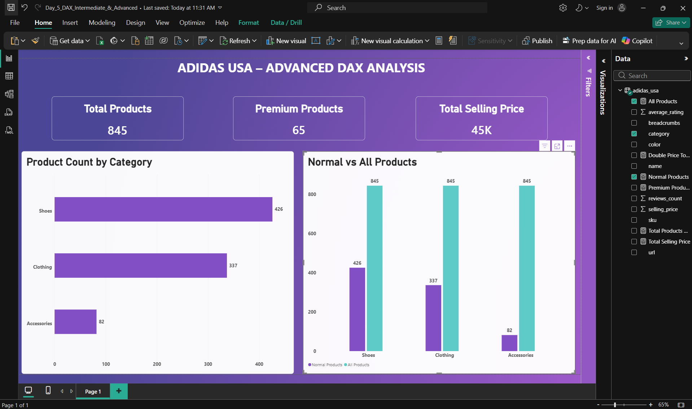

# Adidas USA – Intermediate & Advanced DAX Analysis Dashboard

## 📊 Project Overview

I developed a Power BI dashboard using the Adidas USA product dataset to practise intermediate and advanced DAX functions, analyse product categories, and understand how filter context affects calculations.

The main objective was to strengthen my understanding of DAX functions, including FILTER(), ALL(), REMOVEFILTERS(), and SUMX(), and apply these concepts to practical business intelligence reporting.

This project focuses on DAX calculations, row context, filter context, and advanced analytical techniques using Microsoft Power BI.

## 🛠️ Tools & Technologies

- **Microsoft Power BI Desktop** – Dashboard development, data analysis, and visualization
- **DAX (Data Analysis Expressions)** – Creating measures and performing advanced calculations
- **Microsoft Excel** – Source dataset
- **Power BI Model View** – Managing and reviewing calculated measures

## 📁 Dataset Information

The dataset contains **845 Adidas USA product records** across three main categories:

- Shoes
- Clothing
- Accessories

Key columns used in this analysis include:

- `category`
- `selling_price`
- `average_rating`
- `reviews_count`
- `sku`

**Dataset File:** `adidas_usa.xlsx`

**Dataset Source:** This project uses the `adidas_usa.xlsx` dataset containing 845 Adidas USA product records. The dataset is included in the Day 5 project folder and was originally introduced in the [Day 1 project](https://github.com/Alirazasadaq6/Power-BI-Practice/tree/main/Day-01-Adidas-Product-Analysis).

## 🧮 DAX Functions & Measures

### 1. FILTER() – Premium Products

Used the FILTER() function to identify products with a selling price greater than $100.

```dax
Premium Products =
COUNTROWS(
    FILTER(
        'adidas_usa',
        'adidas_usa'[selling_price] > 100
    )
)
```

**Result:** 65 premium products.

This measure demonstrates how FILTER() evaluates conditions and returns rows that satisfy specific criteria.

### 2. ALL() – Total Products Ignoring Category Filters

Used the ALL() function to calculate the total number of products while removing filters from the category column.

```dax
All Products =
CALCULATE(
    COUNTROWS('adidas_usa'),
    ALL('adidas_usa'[category])
)
```

**Result:** 845 products across all categories.

This measure demonstrates how ALL() removes category filters while preserving other applicable filters.

### 3. REMOVEFILTERS() – Filter Context Modification

Used REMOVEFILTERS() to remove category filters from the product count calculation.

```dax
Total Products No Filter =
CALCULATE(
    COUNTROWS('adidas_usa'),
    REMOVEFILTERS('adidas_usa'[category])
)
```

**Result:** 845 products when no other filters are applied.

This measure helped demonstrate the similarities and differences between ALL() and REMOVEFILTERS().

### 4. SUMX() – Row-by-Row Calculations

Used SUMX() to perform calculations on individual product rows and aggregate the results.

```dax
Double Price Total =
SUMX(
    'adidas_usa',
    'adidas_usa'[selling_price] * 2
)
```

This measure calculates twice the selling price for each product and then sums the calculated values.

### 5. SUM() – Total Selling Price

Used SUM() to calculate the total selling price across all products.

```dax
Total Selling Price =
SUM('adidas_usa'[selling_price])
```

**Result:** Approximately 45K.

### 6. COUNTROWS() – Normal Products

Used COUNTROWS() to calculate the number of products within the current filter context.

```dax
Normal Products =
COUNTROWS('adidas_usa')
```

This measure responds to category filters and was used to compare category-specific counts against the overall product count.

## 🧠 Row Context vs Filter Context

Studied and practised two important DAX concepts.

**1. Row Context**

- Evaluates expressions for individual rows.
- Commonly used in calculated columns and iterator functions.
- Practised using SUMX() to perform row-by-row calculations.

**2. Filter Context**

- Determines which rows are included in a calculation.
- Can be affected by visual filters, slicers, and DAX expressions.
- Practised using CALCULATE(), ALL(), and REMOVEFILTERS().

Understanding these concepts helped me interpret how DAX measures behave under different filtering conditions.

## 📈 Dashboard KPIs

| KPI | Value |
|---|---|
| Total Products | 845 |
| Premium Products | 65 |
| Total Selling Price | Approximately 45K |

These KPIs provide an overview of the Adidas USA product dataset and demonstrate the use of DAX measures in Power BI.

## 📊 Dashboard Visualizations

### 1. Product Count by Category

A clustered bar chart displaying the number of products in each category.

| Category | Product Count |
|---|---:|
| Shoes | 426 |
| Clothing | 337 |
| Accessories | 82 |
| **Total** | **845** |

This visualization helps identify the distribution of Adidas products across categories.

### 2. Normal vs All Products

A clustered column chart comparing the number of products in each category against the overall product count.

The chart uses two DAX measures:

- **Normal Products:** Calculates the number of products within each category.
- **All Products:** Removes category filters and returns the overall product count.

The visualization demonstrates how the ALL() function changes filter context and affects DAX calculations.

### 3. KPI Cards

Three KPI cards displaying:

- Total Products
- Premium Products
- Total Selling Price

These cards provide a quick summary of important product metrics.

## 🔍 Key Business Insights

Based on the dashboard:

- The Adidas USA dataset contains **845 products** across three categories.
- Shoes represent the largest category, with **426 products**, approximately 50.4% of the dataset.
- Clothing is the second-largest category, containing **337 products**, approximately 39.9%.
- Accessories represent the smallest category, with **82 products**, approximately 9.7%.
- The dataset contains **65 premium products** with selling prices greater than $100.
- Premium products represent approximately **7.7%** of the total product records.
- The sum of product selling prices is approximately **45K**.
- The ALL() measure returns 845 products for each category when no other filters are applied, demonstrating category filter removal.

These findings highlight product distribution, premium product availability, and the importance of DAX filter context in business reporting.

## 🎯 Skills Demonstrated

- Intermediate and Advanced DAX Functions
- FILTER() Function
- ALL() Function
- REMOVEFILTERS() Function
- SUMX() Iterator Function
- SUM() and COUNTROWS() Aggregations
- Row Context Understanding
- Filter Context Understanding
- DAX Measure Creation
- Filter Context Modification
- Category-Based Product Analysis
- KPI Card Development
- Clustered Bar and Column Charts
- DAX Measure Comparison
- Dashboard Design and Formatting
- Business Intelligence Reporting

## 🖼️ Dashboard Preview

The dashboard presents product distribution, premium product counts, total selling prices, and comparisons between normal and filter-independent DAX measures.



## 📂 Project Files

| File | Description |
|---|---|
| `Day_5_DAX_Intermediate_&_Advanced.pbix` | Power BI project containing DAX measures and the advanced analysis dashboard |
| `adidas_usa.xlsx` | Original Adidas USA Excel dataset containing 845 product records |
| `dashboard.png` | Screenshot of the completed Power BI dashboard |
| `README.md` | Project documentation covering DAX functions, dashboard visualizations, and learning outcomes |

## 📚 Learning Outcome

This project helped me develop practical skills in writing intermediate and advanced DAX expressions and understanding how different functions affect calculations in Microsoft Power BI.

I gained hands-on experience using FILTER(), ALL(), REMOVEFILTERS(), and SUMX(), and learned the difference between row context and filter context.

I also learned how to compare category-specific measures with overall totals and present analytical results through KPI cards and comparison charts.

