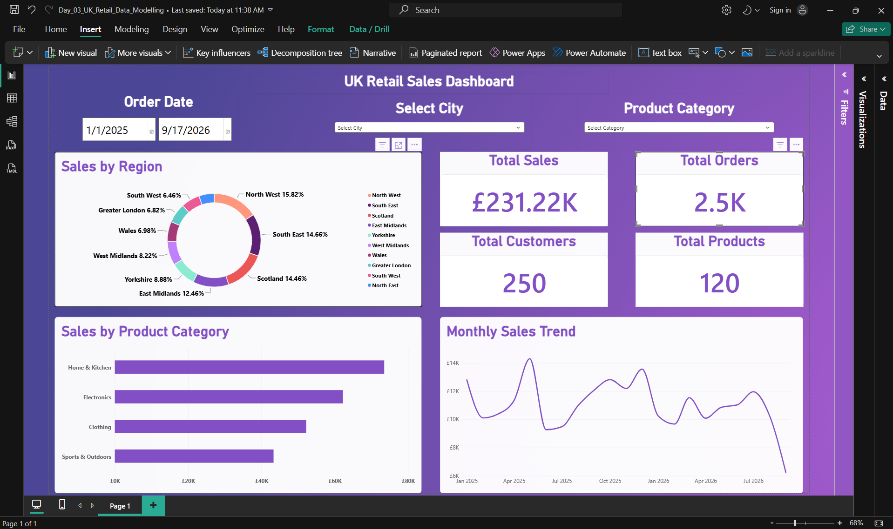
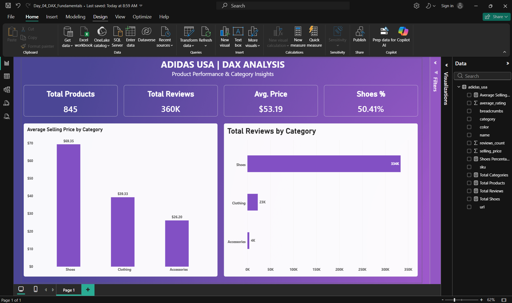
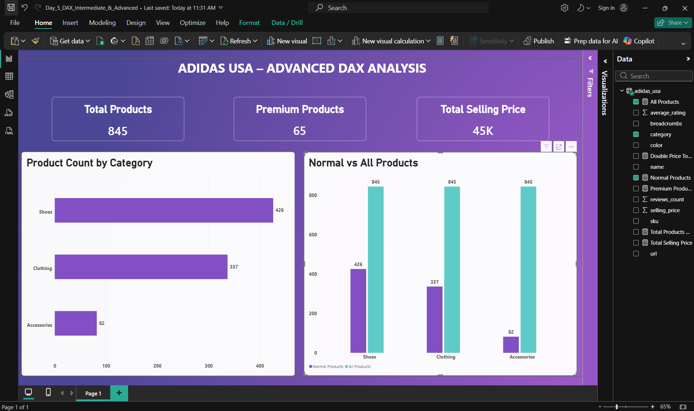

# Power BI Practice Portfolio

## 📊 Project Overview

Five hands-on Power BI practice projects covering data cleaning, relational data modelling, DAX calculations, and interactive dashboard development.

The portfolio demonstrates the core Power BI workflow, from preparing Excel datasets in Power Query to implementing a star schema, creating DAX measures, and presenting analytical findings through interactive reports.

The projects use two datasets: an Adidas USA product catalogue containing 845 products and a synthetic UK retail dataset containing 2,500 sales transactions.

## 🛠️ Tools & Technologies

- **Power BI Desktop** – Data modelling, reporting, and visualisation
- **Power Query (M)** – Data cleaning, transformation, and validation
- **DAX** – Measures, aggregations, iterators, and filter context
- **Microsoft Excel** – Source datasets

## 📁 Dataset Information

| Dataset | Records | Used In |
|---|---|---|
| `adidas_usa.xlsx` | 845 products | Projects 01, 02, 04, 05 |
| `Day3_UK_Retail_3_Tables.xlsx` | 2,500 sales transactions | Project 03 |

**Adidas USA:** Product catalogue covering Shoes, Clothing, and Accessories, including selling prices, ratings, and customer reviews.

**UK Retail:** Synthetic dataset containing Customers (250), Products (120), and Sales (2,500), covering January 2025 to September 2026.

**Dataset Source:** [Adidas Fashion Retail Products Dataset – Kaggle](https://www.kaggle.com/datasets/thedevastator/adidas-fashion-retail-products-dataset-9300-prod/)

The UK retail dataset was created for practice and contains no real customer information.

## 📈 Power BI Projects

| # | Project | Focus | Key Techniques |
|---|---|---|---|
| 01 | [Adidas USA – Product Analysis](Day-01-Adidas-Product-Analysis/) | Dashboard Development | KPI cards, category analysis, charts, slicers |
| 02 | [Adidas USA – Data Cleaning](Day-02-Adidas-Data-Cleaning/) | Power Query | Data profiling, duplicates, split/merge, M functions |
| 03 | [UK Retail Sales – Data Modelling](Day-03-UK-Retail-Data-Modelling/) | Star Schema | Fact/dimension tables, relationships, sales analysis |
| 04 | [Adidas USA – DAX Fundamentals](Day-04-DAX-Fundamentals/) | DAX Measures | `COUNTROWS`, `SUM`, `AVERAGE`, `DISTINCTCOUNT`, `CALCULATE`, `DIVIDE` |
| 05 | [Adidas USA – Intermediate DAX](Day-05-DAX-Intermediate-Advanced/) | Filter Context | `FILTER`, `ALL`, `REMOVEFILTERS`, `SUMX` |

## 📊 Project Highlights

### 01 – Adidas USA Product Analysis

Developed an interactive dashboard analysing product distribution, pricing, ratings, and reviews.

| Dashboard KPI | Value |
|---|---:|
| Total Products | 845 |
| Average Selling Price | $53.19 |
| Average Rating | 4.61 |
| Total Reviews | Approximately 360K |

**Key Findings:** Shoes represent the largest category (426 products) and have the highest average selling price ($69.35), followed by Clothing ($39.33) and Accessories ($26.20).

**Skills:** Power Query basics, KPI cards, clustered charts, category slicers, and report formatting.

[View Project](Day-01-Adidas-Product-Analysis/)

### 02 – Adidas USA Data Cleaning

Performed data cleaning and transformation using Power Query Editor to improve data quality and consistency.

**Key Transformations:**

- Validated data types and profiled column quality
- Identified and removed duplicates and blank rows
- Split and merged breadcrumb columns
- Standardised category names using Replace Values
- Applied Trim, Clean, and text formatting
- Extracted SKU prefixes
- Reviewed Applied Steps and M expressions

**M Functions:** `Text.Trim()`, `Text.Clean()`, `Text.Upper()`, `Text.Lower()`, `Text.Proper()`, `Text.Start()`, `Text.End()`, `Text.Middle()`, `Table.ReplaceValue()`

**Skills:** Data profiling, text transformations, data validation, and Power Query M fundamentals.

[View Project](Day-02-Adidas-Data-Cleaning/)

### 03 – UK Retail Sales Data Modelling

Implemented a star schema using three related tables and developed an interactive retail sales dashboard.

**Data Model:**

- Fact table: `Sales`
- Dimension tables: `Customers`, `Products`
- `Customers[CustomerID]` → `Sales[CustomerID]` (1:*)
- `Products[ProductID]` → `Sales[ProductID]` (1:*)

| Dashboard KPI | Value |
|---|---:|
| Total Sales | £231.22K |
| Total Orders | 2,500 |
| Total Customers | 250 |
| Total Products | 120 |

**Key Findings:** Home & Kitchen generated the highest sales, followed by Electronics. North West contributed approximately 15.82% of sales, while South East contributed 14.66%.

**Skills:** Star schema, relationship cardinality, cross-filter direction, active/inactive relationships, regional analysis, and interactive reporting.

[View Project](Day-03-UK-Retail-Data-Modelling/)

### 04 – Adidas USA DAX Fundamentals

Created reusable DAX measures to analyse product distribution, selling prices, and customer reviews.

**DAX Functions:** `COUNTROWS()`, `SUM()`, `AVERAGE()`, `DISTINCTCOUNT()`, `CALCULATE()`, `DIVIDE()`

| Dashboard KPI | Value |
|---|---:|
| Total Products | 845 |
| Total Reviews | Approximately 360K |
| Average Selling Price | $53.19 |
| Shoes Percentage | 50.41% |

**Additional Measure:** Total Categories = 3 (not displayed as a dashboard KPI).

**Key Findings:** Shoes account for 50.41% of products and approximately 334K reviews. Clothing and Accessories account for approximately 23K and 4K reviews, respectively.

**Skills:** DAX measures, aggregation functions, filter context, `CALCULATE`, `DIVIDE`, and percentage calculations.

[View Project](Day-04-DAX-Fundamentals/)

### 05 – Adidas USA Intermediate & Advanced DAX

Practised DAX calculations to understand row context, filter context, and context modification.

**DAX Functions:**

- `FILTER()` – Identify products priced above $100
- `ALL()` – Remove category filters
- `REMOVEFILTERS()` – Modify filter context
- `SUMX()` – Perform row-by-row calculations
- `SUM()` and `COUNTROWS()` – Aggregate and count product records

| Dashboard KPI | Value |
|---|---:|
| Total Products | 845 |
| Premium Products (Price > $100) | 65 |
| Sum of List Prices | $44,948 |

*The sum of list prices represents the combined listed prices of catalogue products, not actual sales revenue.*

**Key Findings:** Shoes account for 50.4% of products, Clothing 39.9%, and Accessories 9.7%. Premium products represent approximately 7.7% of the catalogue.

**Skills:** DAX iterators, row and filter context, context modification, and measure comparison.

[View Project](Day-05-DAX-Intermediate-Advanced/)

## 🖼️ Dashboard Previews

### UK Retail Sales – Project 03



### Adidas USA DAX Fundamentals – Project 04



### Adidas USA Advanced DAX – Project 05



## 🎯 Skills Demonstrated

**Power Query:** Data profiling, type validation, duplicate handling, split/merge columns, text transformations, Applied Steps, and M expressions.

**Data Modelling:** Fact and dimension tables, star schema, primary/foreign keys, one-to-many relationships, cross-filter direction, and relationship management.

**DAX:** `COUNTROWS`, `SUM`, `AVERAGE`, `DISTINCTCOUNT`, `CALCULATE`, `DIVIDE`, `FILTER`, `ALL`, `REMOVEFILTERS`, `SUMX`, row context, and filter context.

**Reporting:** KPI cards, clustered bar/column charts, line charts, donut charts, interactive slicers, date filtering, currency formatting, and dashboard design.

## 📂 Repository Structure

```text
Power-BI-Practice/
├── Day-01-Adidas-Product-Analysis/
├── Day-02-Adidas-Data-Cleaning/
├── Day-03-UK-Retail-Data-Modelling/
├── Day-04-DAX-Fundamentals/
├── Day-05-DAX-Intermediate-Advanced/
└── README.md
```

Each folder contains a `.pbix` project file, a dashboard or Power Query screenshot, and its own README. Relevant Excel datasets are included in the project folders.

## 🚀 How to Open the Projects

1. Install [Microsoft Power BI Desktop](https://www.microsoft.com/en-gb/power-platform/products/power-bi/desktop).
2. Clone or download this repository.
3. Open the `.pbix` file in the relevant project folder.
4. Explore the reports, relationships, DAX measures, and Power Query transformations.

**Note:** To refresh the data, update the Excel source path in Power Query or Data Source Settings to match the dataset location on your computer.

## 📚 Learning Outcomes

These projects helped me progress from basic dashboard development to relational data modelling and intermediate DAX calculations.

I gained practical experience in preparing datasets, managing relationships, writing reusable measures, understanding evaluation context, and presenting analytical findings through interactive Power BI reports.

## 🎯 Portfolio Objective

I am developing practical data analytics skills in Power BI and Excel, alongside my continued learning and practice in SQL and Python.

This repository demonstrates my Power BI learning through independent projects focused on data preparation, modelling, analytical calculations, and reporting.

**All projects are independent practice exercises and do not represent professional employment experience.**

## 🔗 Connect With Me

- **LinkedIn:** [Ali Raza](https://www.linkedin.com/in/alirazasadaq)
- **GitHub:** [Alirazasadaq6](https://github.com/Alirazasadaq6)
